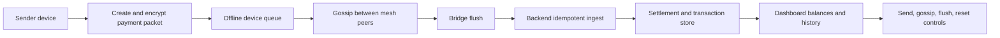

<p align="center">
  
</p>

<h1 align="center">UPI Offline Mesh
</h1>

FastAPI demo of offline payment packets moving through a simulated mesh and settling once a bridge device reaches the backend.

The UI is intentionally minimal and responsive so the packet flow is easy to follow on desktop and mobile.

An offline payment is packaged and encrypted on a device, then relayed across the simulated mesh. A bridge forwards queued packets to the backend, where idempotent ingestion prevents duplicate delivery from settling the same packet twice.



The UI exposes each step so the packet lifecycle can be followed. This is a local simulation with an in-memory SQLite store, not a connection to a real UPI rail or bank.

## Run it

```bash
python -m venv .venv
.venv\Scripts\activate
pip install -r requirements.txt
python main.py
```

Open http://localhost:8080 for the dashboard.

## What it includes

- FastAPI backend with REST endpoints under `/api`
- In-memory SQLite data store
- Hybrid encryption for payment packets
- Idempotent bridge ingestion and settlement
- A small browser dashboard for sending, gossiping, flushing, and resetting packets
- A responsive layout that stays usable on smaller screens

## Main routes

| Method | Path                 | Purpose                            |
| ------ | -------------------- | ---------------------------------- |
| `GET`  | `/`                  | Dashboard                          |
| `GET`  | `/api/accounts`      | Account balances                   |
| `GET`  | `/api/transactions`  | Recent settlements                 |
| `GET`  | `/api/mesh/state`    | Device state                       |
| `POST` | `/api/demo/send`     | Create a demo packet               |
| `POST` | `/api/mesh/gossip`   | Run one gossip round               |
| `POST` | `/api/mesh/flush`    | Upload packets from bridge devices |
| `POST` | `/api/mesh/reset`    | Clear the mesh                     |
| `POST` | `/api/bridge/ingest` | Bridge ingest endpoint             |

## Tests

```bash
pytest tests/ -v
```

